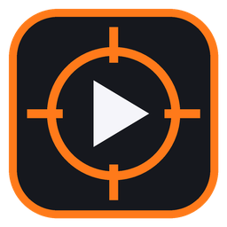
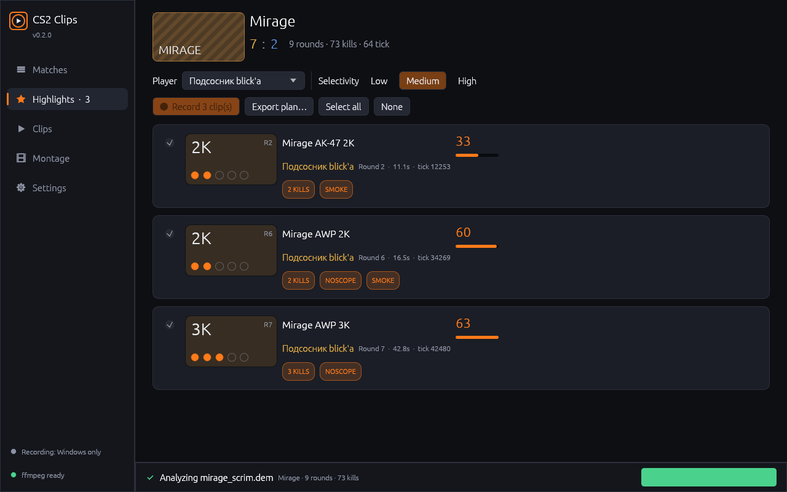
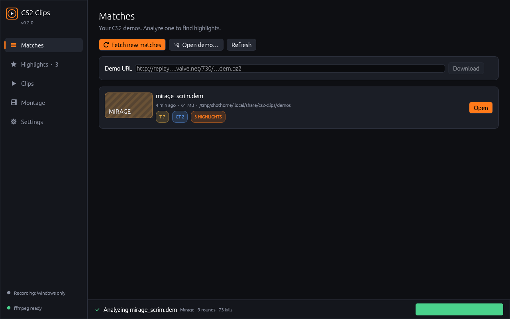
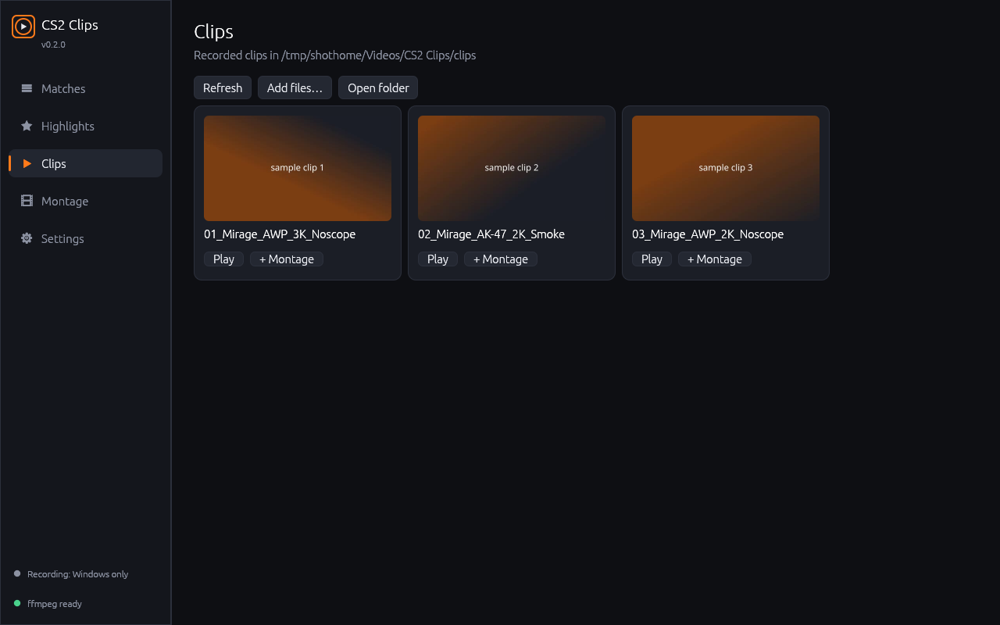
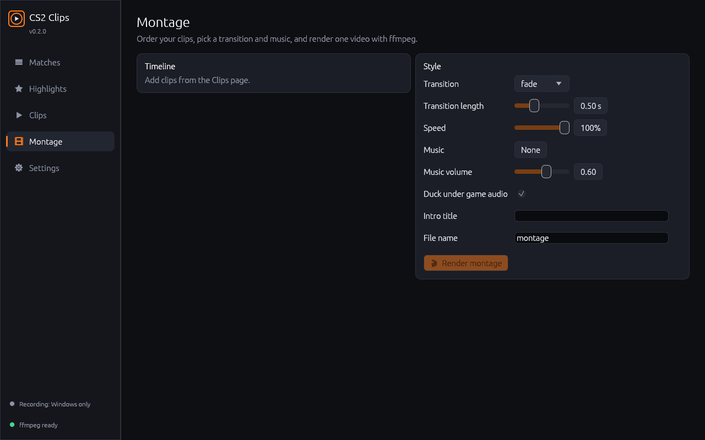
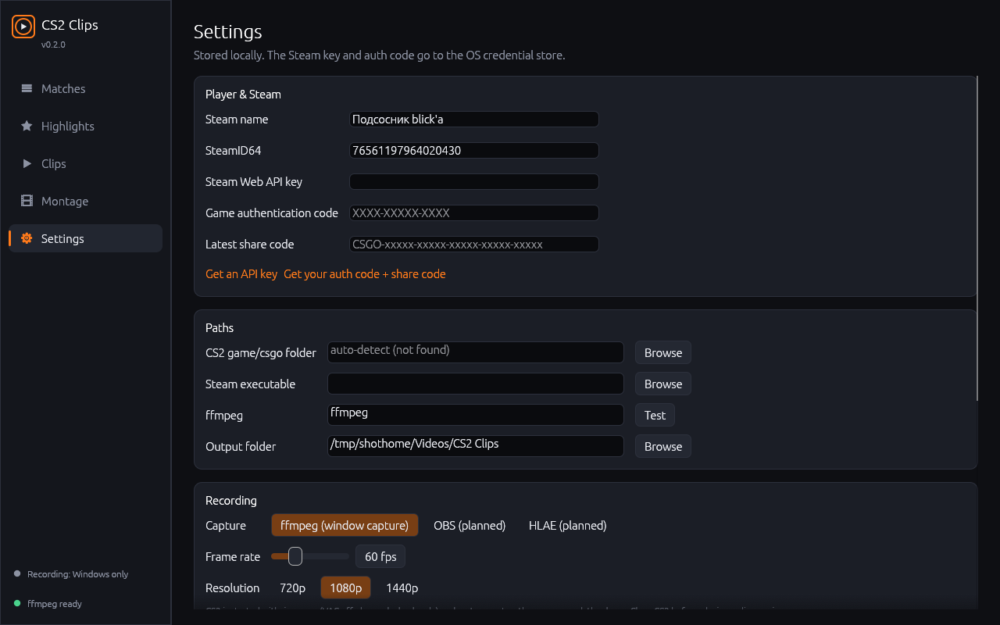

<p align="center"></p>
<h1 align="center">CS2 Clips</h1>

<p align="center">🌐 <b>Website:</b> <a href="https://xdkurbie.github.io/cs2-clips/">xdkurbie.github.io/cs2-clips</a> — built in Rust (Leptos + WebAssembly), source in <a href="site/">site/</a></p>

<p align="center">Find your best Counter-Strike 2 moments in demos, record them through CS2's own demo player and cut them into a montage. Runs locally, written in Rust.</p>
<p align="center">
  <a href="https://github.com/xdkurbie/cs2-clips/actions/workflows/ci.yml"></a>
  <a href="https://github.com/xdkurbie/cs2-clips/releases/latest"></a>
</p>



| Matches | Clips | Montage | Settings |
|---|---|---|---|
|  |  |  |  |

<sub>Screenshots are the real app, rendered on Linux with a public CS2 test demo (de_mirage). The clip thumbnails are generated sample videos, not real recordings.</sub>

## Features

- **Matches**: lists demos from your CS2 `replays` folder (auto-detected across Steam libraries), the app's own demo folder and extra folders. Opens `.dem` and `.dem.bz2` files and downloads replay URLs with progress.
- **Steam match history**: walks new share codes with the official `GetNextMatchSharingCode` Web API using your API key and game authentication code.
- **Highlight detection**: 2K–5K, aces, won 1vX clutches (merged with the multikill of the same round), noscopes, wallbangs, kills through smoke, blind kills and optional headshots. A rule file controls scoring, a multikill time window, pre-/post-roll, per-weapon bonuses and selectivity (low / medium / high).
- **Recording (Windows)**: launches CS2 with `-insecure` (VAC off, demo playback only) and `-netconport`, then sends `playdemo`, `demo_gototick`, `spec_player_by_accountid` and `demo_resume` over the console port and captures the CS2 window with ffmpeg.
- **Montage**: reorder clips and pick an xfade transition, slow motion, an intro title and music that ducks under the game audio. Renders with ffmpeg and shows live progress.
- **CLI** (`cs2clips`) for everything except recording: `scan`, `info`, `sharecode`, `matches`, `download`, `cfg`, `montage`, `login`.

## Safety

Recording uses only CS2's built-in demo player: no injection, no memory reading, no anti-cheat bypass. CS2 is started with `-insecure`, so it cannot join VAC-secured servers in that session, and only an allow-list of demo, spectator and cosmetic console commands is ever sent. Close CS2 before playing online again.

## Install

Download from [Releases](https://github.com/xdkurbie/cs2-clips/releases/latest):

- **Windows x64**: `CS2Clips-windows-x64.exe`, or the zip, which also includes the CLI.
- **macOS (Apple silicon + Intel)**: `CS2Clips-macos-universal.zip`. The app is ad-hoc signed but not notarized, so right-click → **Open** the first time. On macOS you can browse matches, analyze demos and build montages. Recording needs CS2 on Windows.

Install **ffmpeg** (and ffprobe) for clips and montages: `winget install Gyan.FFmpeg` on Windows or `brew install ffmpeg` on macOS. You can also set its full path in Settings.

## Setup

1. **Settings → Player & Steam**: enter your Steam name. Your SteamID64 is filled in automatically the first time you appear in a demo.
2. **Steam Web API key**: <https://steamcommunity.com/dev/apikey>.
3. **Game authentication code and latest share code**: Steam Help → *Access to your match history*: <https://help.steampowered.com/en/wizard/HelpWithGameIssue/?appid=730&issueid=128>.
4. **CS2 folder**: usually detected. Otherwise point it to `…/steamapps/common/Counter-Strike Global Offensive/game/csgo`.
5. **ffmpeg**: leave it as `ffmpeg` if it is on your PATH, or browse to `ffmpeg.exe`.

The API key and auth code are stored in the OS credential store (Windows Credential Manager or macOS Keychain), never in `settings.json`, and are never logged.

> **Limitation:** Steam's API returns share codes but not demo download links. Only the CS2 Game Coordinator knows those, and it needs a logged-in game client. Copy the replay link from CS2 (*Watch → Your Matches*) or a stats site and paste it into **Demo URL**, or open demos already in your `replays` folder.

## CLI

```text
cs2clips scan match.dem --player rasu420 --plan plan.json   # list highlights + write a clip plan
cs2clips scan match.dem --all --json
cs2clips info match.dem
cs2clips sharecode CSGO-GADqf-jjyJ8-cSP2r-smZRo-TO2xK
cs2clips matches                                              # new share codes since the last one
cs2clips download "http://replay…/730/….dem.bz2"
cs2clips cfg plan.json --index 0                              # writes cfg/cs2clips.cfg → `exec cs2clips`
cs2clips montage a.mp4 b.mp4 --music song.mp3 --transition fadeblack --slowmo 0.8 -o best.mp4
```

## Rules

See [`rules.example.yaml`](rules.example.yaml). Every key is optional, and unknown keys are rejected so a typo never fails silently.

## Architecture

```
crates/
  core/   cs2clips-core: sharecode, steam, download, demo (source2-demo), detect, rules, plan, record, montage, config
  gui/    CS2Clips: eframe/egui desktop app
  cli/    cs2clips: command line
```

- **Demo parsing** uses [`source2-demo`](https://crates.io/crates/source2-demo), a maintained pure-Rust Source 2 parser with a `cs2` feature. It reads `player_death`, `round_freeze_end` and `round_end` events and the `CCSPlayerController` and game-rules entities. A 60 MB demo parses in about 0.3 s.
- **Detection** works on plain data (`MatchData`), so every rule is unit-tested without demo files.
- **GUI** uses egui/eframe: a single native binary with no web runtime, a custom dark theme, and background jobs with progress and cancel.

## Development

```bash
cargo test --workspace                       # unit tests
CS2CLIPS_TEST_DEMO=path/to/demo.dem cargo test -p cs2clips-core --test real_demo
cargo clippy --workspace --all-targets -- -D warnings
cargo run --release -p cs2clips-gui
```

CI downloads the public test demo from the demoparser repository and runs the real-demo integration test (73 kills, 10 players, de_mirage).

## Status

| Area | Status |
|---|---|
| Share codes, rules, detection, clip plans, bz2 | Unit-tested |
| Demo parsing | Tested on one public CS2 demo, and kill counts and flags match demoparser2 |
| Steam match history | Tested against a mocked HTTP layer, not yet against the live API |
| Montage rendering | Tested with real ffmpeg on generated clips |
| Recording (CS2 + netcon + ffmpeg) | Implemented, **not yet tested end-to-end** on Windows with CS2 |
| OBS / HLAE capture | Planned, not implemented. Use the ffmpeg backend |

The original Python version is on the [`legacy-python`](https://github.com/xdkurbie/cs2-clips/tree/legacy-python) branch and the `v0.1.0` tag.

Inspired by cloud highlight services, but all code and graphics here are original. Not affiliated with Valve. MIT license.
